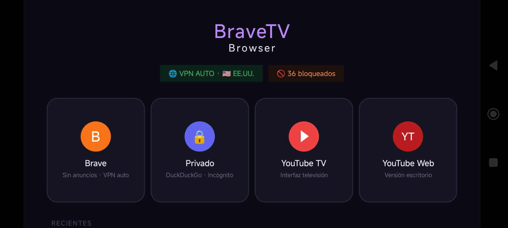
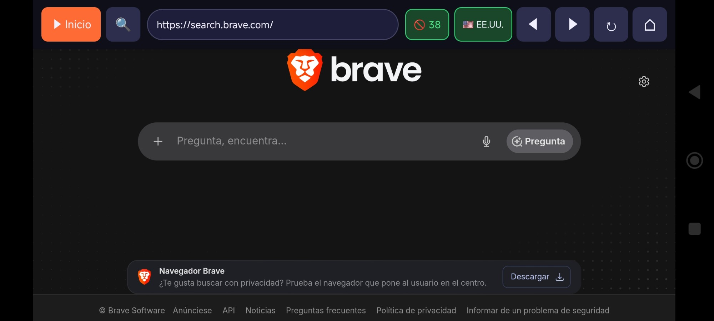
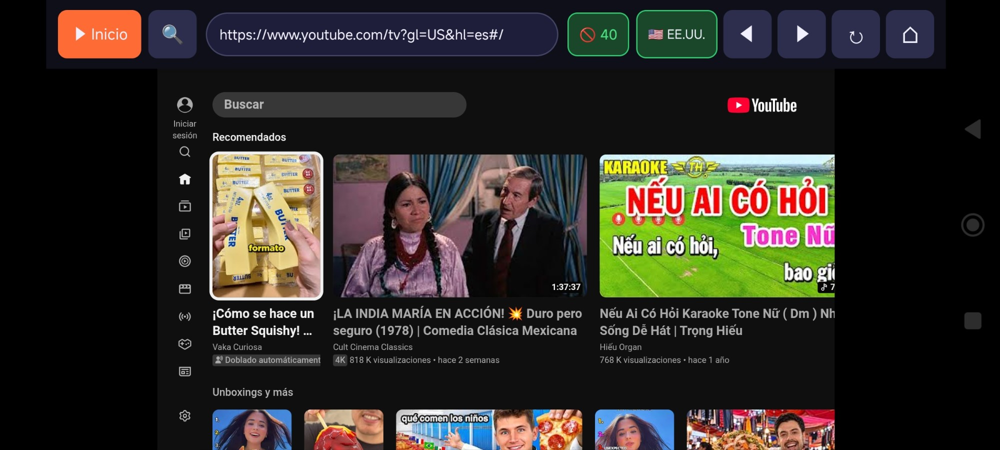

<div align="center">

# 🦁 BraveTV Browser

**Navegador Android TV con bloqueador de anuncios, bypass de geo-restricciones y modo privado**

[](https://github.com/jdans01/BraveTV/actions/workflows/build.yml)
[](https://github.com/jdans01/BraveTV/releases/latest)


[📦 Descargar APK](#-instalación) · [✨ Funciones](#-funciones) · [🖼️ Capturas](#️-capturas) · [🔧 Compilar](#-compilar-desde-el-código-fuente)

</div>

---

## ✨ Funciones

### 🛡️ Bloqueo de anuncios
- Bloquea más de **30 dominios publicitarios** (DoubleClick, Google Ads, imasdk, pagead, etc.)
- Elimina anuncios pre-roll y mid-roll de YouTube antes de que carguen
- Oculta banners, overlays y elementos promocionales vía CSS injection
- Auto-skip de anuncios que logran pasar el filtro
- **Contador en tiempo real** de anuncios y rastreadores bloqueados

### 🌍 Bypass de geo-restricciones (VPN AUTO)
- Cambia automáticamente de región cuando YouTube detecta y bloquea el acceso
- 10 regiones disponibles: 🇺🇸 EE.UU. · 🇬🇧 UK · 🇩🇪 Alemania · 🇨🇦 Canadá · 🇫🇷 Francia · 🇳🇱 Países Bajos · 🇸🇪 Suecia · 🇨🇭 Suiza · 🇦🇺 Australia · 🇯🇵 Japón
- Selección manual de región (pulsación larga sobre el botón VPN)
- Cookies de región aplicadas automáticamente para resultados locales

### 🏠 Pantalla de inicio
| Modo | Descripción |
|------|-------------|
| **Brave Browser** | Abre `brave.com/search/`; las consultas van a `search.brave.com` |
| **Brave Privado** | Abre `duckduckgo.com` en modo incógnito (sin cookies ni historial) |
| **YouTube TV** | YouTube optimizado para pantalla grande con user-agent de Smart TV |
| **YouTube Web** | YouTube versión escritorio con Chrome user-agent |

### 📺 Optimizado para Android TV
- Navegación completa por **D-pad** (mando a distancia)
- Scroll con flechas arriba/abajo en páginas web
- Cursor alternable con la tecla **MENÚ** del control remoto
- YouTube Web con selección automática hasta HD/4K, según la calidad disponible
- **Pantalla completa automática** durante reproducción de video
- Barra de navegación se **oculta automáticamente** en modo fullscreen
- Compatible con: **Hisense · TCL · Sony · Philips · Mi Box · NVIDIA Shield** y cualquier Android TV

### 🕑 Historial reciente
- Últimas 8 páginas visitadas en la pantalla de inicio
- Acceso con un clic al contenido reciente

### 🔍 Búsqueda rápida
- Botón de búsqueda directa en YouTube (también con tecla `SEARCH` del mando)
- Barra de URL editable para navegar a cualquier sitio

---

## 📦 Instalación

### Opción A — Descarga directa (recomendado)

**[⬇ Descargar BraveTVBrowser.apk (última versión)](https://github.com/jdans01/BraveTV/releases/latest/download/BraveTVBrowser.apk)** — Android 5.0+

Este enlace siempre apunta a la versión más reciente publicada. También podés ver todas las
versiones (con notas de cada una) en la pestaña **[Releases](https://github.com/jdans01/BraveTV/releases)**,
o descargar el build de cualquier commit individual desde **[Actions](../../actions/workflows/build.yml)**.

> A partir de la v2.1, la propia app avisa dentro de la pantalla de inicio cuando hay una
> versión más nueva disponible — no hace falta volver a este enlace cada vez.

### Transferir e instalar en tu Android TV

#### Método 1 — ADB por red Wi-Fi (sin cables)

```bash
# 1. En tu TV: Ajustes → Sobre el dispositivo → Compilación (toca 7 veces)
#    Luego: Ajustes → Preferencias del dispositivo → Opciones para desarrolladores
#    Activa "Depuración por ADB" y anota la IP del TV

# 2. Desde tu PC (con ADB instalado):
adb connect 192.168.1.XXX:5555
adb install -r BraveTVBrowser.apk

# 3. La app aparece en el launcher del TV
```

#### Método 2 — USB OTG (pendrive)

1. Copia el APK a un pendrive USB
2. Conéctalo al TV y abre un explorador de archivos (p. ej. **FX File Explorer** o **X-plore**)
3. Navega hasta el APK y pulsa **Instalar**
4. Activa "Fuentes desconocidas" si el TV lo solicita

#### Método 3 — Send Files to TV

1. Instala **[Send Files to TV](https://play.google.com/store/apps/details?id=com.yablio.sendfilestotv)** en TV y móvil
2. Envía el APK desde tu móvil al TV
3. Ábrelo con el explorador de archivos del TV e instala

#### Activar instalación desde fuentes desconocidas

> Si el TV bloquea la instalación:
>
> **Ajustes → Seguridad → Fuentes desconocidas → Activar** (o en Android TV 9+: Ajustes → Preferencias del dispositivo → Seguridad y restricciones)

---

## 🎮 Controles

| Acción | Control |
|--------|---------|
| Navegar entre cards | ← → ↑ ↓ (D-pad) |
| Seleccionar | OK / Enter |
| Scroll en página web | ↑ ↓ (D-pad) |
| Volver / cerrar browser | Botón Back |
| Ir a pantalla de inicio | Botón Home (en barra nav) |
| Búsqueda rápida YouTube | Botón 🔍 Search del mando |
| Mostrar barra nav (si oculta) | Botón Back |
| Cambiar región VPN | Pulsación larga sobre botón VPN |
| Activar/desactivar VPN AUTO | Clic sobre botón VPN |

---

## 🖼️ Capturas

| Pantalla de inicio | Brave Search | YouTube TV |
|:-:|:-:|:-:|
|  |  |  |
| 4 modos · contador de bloqueos · VPN status | brave.com/search · 38 anuncios bloqueados | YouTube TV optimizado para pantalla grande |

---

## 🔧 Compilar desde el código fuente

### Requisitos

- **Java 11** o superior
- **Android SDK** con API 34 instalada
- **Gradle 8.7** (se descarga automáticamente via wrapper)

### Pasos

```bash
# Clonar el repositorio
git clone https://github.com/jdans01/BraveTV.git
cd BraveTV

# Compilar APK debug
./gradlew assembleDebug

# El APK estará en:
# app/build/outputs/apk/debug/app-debug.apk
```

### Compilar APK release

```bash
./gradlew assembleRelease
# app/build/outputs/apk/release/app-release.apk
```

Sin las variables `RELEASE_KEYSTORE_PATH`/`RELEASE_KEYSTORE_PASSWORD`/`RELEASE_KEY_ALIAS`/
`RELEASE_KEY_PASSWORD` en el entorno, cae en la llave de debug (solo para desarrollo local —
no se puede instalar encima de una build ya firmada con la llave estable). CI sí las tiene
configuradas como secrets del repo, así que todas las builds oficiales comparten la misma
firma y pueden actualizarse unas sobre otras sin perder datos.

### CI/CD — GitHub Actions

El workflow `.github/workflows/build.yml` compila y firma el APK en cada push a `main`, lo
publica como artefacto descargable, y además crea un [Release](https://github.com/jdans01/BraveTV/releases)
con el APK adjunto cada vez que se sube un tag `vX.Y`.

---

## 🏗️ Arquitectura

```
app/src/main/
├── java/com/bravetv/browser/
│   └── MainActivity.java          # Actividad principal (WebView + lógica completa)
└── res/
    ├── layout/
    │   └── activity_main.xml      # Layout (home screen + browser + navbar)
    ├── drawable/
    │   ├── card_mode.xml          # Drawable unificado para las 4 cards del home
    │   ├── card_recent.xml        # Drawable para tarjetas de historial reciente
    │   ├── icon_brave_circle.xml  # Ícono naranja "B" — Brave Browser
    │   ├── icon_private_circle.xml# Ícono índigo 🔒 — Modo privado
    │   ├── icon_yttv_circle.xml   # Ícono rojo ▶ — YouTube TV
    │   └── icon_ytweb_circle.xml  # Ícono rojo oscuro "YT" — YouTube Web
    ├── mipmap-*/
    │   └── ic_launcher.png        # Ícono de la app (escudo con león, 5 densidades)
    └── values/
        ├── styles.xml
        └── strings.xml
```

### Componentes clave de `MainActivity.java`

| Componente | Descripción |
|------------|-------------|
| `AD_HOSTS` | Set de 30+ dominios bloqueados |
| `AD_URL_PATTERNS` | Patrones de URL adicionales para bloqueo |
| `isAdUrl()` | Evaluación de cada request antes de cargarlo |
| `blockedCount` | Contador acumulado de bloqueos (se muestra en UI) |
| `AUTO_REGIONS[]` | 10 códigos de región para bypass geo |
| `applyRegion()` | Agrega `gl=` y `hl=es` a URLs de YouTube |
| `applyRegionCookies()` | Aplica cookie `PREF` de región a YouTube |
| `onGeoBlockDetected()` | Cambia región automáticamente al detectar bloqueo |
| `BraveTVInterface` | JS Interface para comunicación WebView → Java |
| `launchMode()` | Enruta cada card a su URL y configura WebView |
| `configureWebViewForMode()` | Cambia user-agent y cookies según modo |
| `setNavBarHidden()` | Oculta/muestra barra con animación |
| `saveRecent()` / `renderRecents()` | Historial persistido en SharedPreferences (JSON) |

---

## 🔒 Privacidad

- **No recopila datos**: la app no envía ningún dato a servidores externos
- **Sin telemetría**: no hay analytics ni tracking de uso
- **Modo incógnito**: limpia cookies, caché e historial al activarse
- **Código abierto**: puedes auditar todo lo que hace la app

---

## 📋 Requisitos del sistema

| Requisito | Mínimo | Recomendado |
|-----------|--------|-------------|
| Android | 5.0 (API 21) | 9.0+ (API 28) |
| RAM | 1 GB | 2 GB+ |
| Almacenamiento | 15 MB | — |
| Red | Wi-Fi o Ethernet | Ethernet (mejor rendimiento) |
| Control | Mando D-pad | Mando Android TV estándar |

**Dispositivos probados:**
- Android TV / Google TV genérico
- Hisense VIDAA (con launcher Android TV)
- TCL Android TV
- Mi Box S / Mi TV Stick
- NVIDIA Shield TV

---

## 🐛 Problemas conocidos y soluciones

| Problema | Solución |
|----------|----------|
| YouTube muestra "Video no disponible en tu país" | VPN AUTO cambia la región automáticamente. Si persiste, mantén pulsado el botón VPN y elige otra región manualmente. |
| La app no aparece en el launcher del TV | Desinstala y reinstala el APK. Algunos TV requieren reiniciar. |
| Videos se pausan solos | Asegúrate de que "Ahorro de energía" no corte la app en segundo plano. |
| Barra de navegación no aparece | Pulsa el botón Back del mando para revelarla. |
| Error "Fuentes desconocidas" al instalar | Sigue las instrucciones de [activar fuentes desconocidas](#activar-instalación-desde-fuentes-desconocidas). |

---

## ☕ Donaciones

Si la app te es útil y quieres apoyar el desarrollo:

| Red | Dirección |
|-----|-----------|
| **Bitcoin (BTC)** | `bc1qa78yurqt2wsuc7nglnpwc867zxgjtcj0ztdzq0` |
| **Solana (SOL)** | `84e1VXoQx5AVdBH29CERnhveNEAQKf1CnFFJxrY1rwSF` |

Cualquier contribución, por pequeña que sea, ayuda a mantener el proyecto activo. ¡Gracias! 🙏

---

## 🤝 Contribuir

1. Haz fork del repositorio
2. Crea una rama: `git checkout -b feature/mi-mejora`
3. Realiza tus cambios y haz commit: `git commit -m "feat: descripción"`
4. Sube la rama: `git push origin feature/mi-mejora`
5. Abre un Pull Request

---

## 📄 Licencia

MIT License — libre para usar, modificar y distribuir.

---

<div align="center">

Hecho con ❤️ para la comunidad Android TV

</div>
